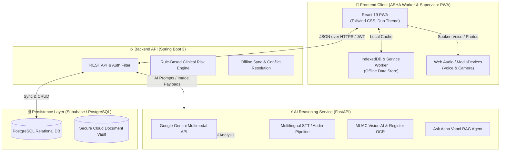

# Asha Vaani (आशा वाणी / ಆಶಾ ವಾಣಿ)
### *Empowering Frontline Healthcare Workers with Offline-First Voice & Vision AI*

[](https://react.dev/)
[](https://spring.io/)
[](https://fastapi.tiangolo.com/)
[](https://ai.google.dev/)
[](https://developer.mozilla.org/en-US/docs/Web/Progressive_web_apps)
[](/)

---

## 📌 Executive Summary

India's **1,000,000+ ASHA (Accredited Social Health Activist) workers** form the indispensable backbone of rural and primary healthcare. Despite their vital role, ASHAs spend up to **30–40% of their working hours manually recording clinical data across 12+ paper registers**. This heavy administrative burden leads to delayed detection of high-risk cases, transcription errors, lack of visibility for district supervisors, and broken coordination with Nutrition Rehabilitation Centres (NRCs) and child welfare NGOs.

**Asha Vaani** transforms frontline healthcare delivery by replacing physical paper logs with an intelligent, voice-first, offline-capable mobile application available in **Hindi (हिंदी)**, **Kannada (ಕನ್ನಡ)**, and **English**. Workers can record consultations through voice, convert handwritten paper registers into structured data with Vision AI, screen children for Severe Acute Malnutrition (SAM) through camera photos, and receive automated, clinical protocol-backed priority visits.

---

## 🌟 Key Features

### 1. 🎙️ Voice-First Conversational Data Entry
- **Multilingual Spoken Input:** ASHAs can fill complex survey forms (Family Surveys, ANC, Child Growth, Immunization) simply by speaking naturally in **Hindi**, **Kannada**, or **English**.
- **Context-Aware Information Extraction:** Real-time AI entity parsing maps spoken dialect sentences directly to structured form inputs without manual typing.
- **Hands-Free Ambient AI Assistant:** Built-in Conversational Agent (`Ask Asha Vaani`) answers clinical health queries and protocol questions directly based on Indian National Health Mission guidelines.

### 2. 📷 Vision AI Handwritten Register Scanning
- **Instant Digitization:** Workers photograph existing handwritten physical registers.
- **Multimodal OCR & Field Extraction:** Powered by Google Gemini Vision to read tables, names, dates, and health metrics, generating preview cards for worker verification before database persistence.

### 3. 👶 Computer Vision Child Malnutrition Screening
- **Non-Invasive SAM / MAM Detection:** Frontline workers take an arm photo of the child using a standard ₹5 coin as a scale reference.
- **Automated Z-Score & MUAC Estimation:** Calculates Mid-Upper Arm Circumference (MUAC) and flags malnutrition categories (Normal, MAM - Moderate Acute Malnutrition, SAM - Severe Acute Malnutrition).
- **Direct NRC Referral:** Instantly generates referral slips for children requiring urgent medical admission.

### 4. 🚨 Algorithmic Risk Scoring & Priority Visit Queue
- **Transparent Risk Engine:** Clinically calibrated formula categorizes beneficiaries into **Critical**, **High**, **Medium**, and **Low** risk based on vitals, anthropometrics, and missed immunization milestones.
- **Actionable Daily Agenda:** Priority List highlights at-risk children and pregnant mothers needing immediate home visits, complete with one-tap GPS navigation to beneficiary homes.

### 5. 🏥 Closing the Screening-to-Care Loop
- **Supervisor Verification Portal:** Primary Health Centre (PHC) medical officers and ASHA Heads monitor village coverage, review flagged cross-field anomalies, and verify referral closures.
- **NGO Coordination:** Connects vulnerable, orphaned, or severely malnourished children with verified local NGOs.
- **Automated Caregiver Reminders:** Generates scheduled bilingual SMS and WhatsApp follow-up reminders for mothers and guardians.

### 6. 📶 Resilient Offline-First Architecture
- **IndexedDB & Service Workers:** Full app functionality remains accessible in deep rural zero-connectivity zones.
- **Automatic Background Sync:** Changes, drafts, and survey submissions are queued locally and synchronized seamlessly when cellular network or Wi-Fi is restored.

### 7. 🎨 High-Contrast Duo UX Theme
- Engineered specifically for outdoor field conditions under bright sunlight and low-cost smartphone screens.
- Palette: **Cream (`#F0EDCC`)** canvas with **Deep Teal (`#02343F`)** active brand anchors for readability and contrast compliance (WCAG AAA).

---

## 🏗️ System Architecture



---

## 🛠️ Technology Stack

| Domain | Technology / Library | Role |
| :--- | :--- | :--- |
| **Frontend** | React 19, Vite, Tailwind CSS v4 | Lightweight Progressive Web App (PWA) |
| **State & Offline** | Zustand, IndexedDB (`idb`), Workbox | Offline-first caching, local queueing & state |
| **Localization** | `i18next`, `react-i18next` | Hindi, Kannada & English dynamic runtime toggling |
| **Backend API** | Spring Boot 3, Java 21, Hibernate/JPA | Authoritative write path, security & risk engine |
| **AI Microservice** | Python 3.11, FastAPI, Uvicorn | Vision AI processing, register extraction, RAG agent |
| **AI Models** | Google Gemini 1.5 / 2.0 Multimodal | Handwritten OCR, voice entity extraction, clinical assistant |
| **Database** | Supabase (PostgreSQL 15) | Relational store for households, members, and health metrics |
| **Visualization** | Recharts, jsPDF, AutoTable | Supervisor analytics, coverage charts, printable PDF reports |

---

## 📂 Repository Structure

```
AshaVaani/
├── asha-ai/
│   ├── frontend/               # React 19 PWA (ASHA Mobile App & Supervisor Portal)
│   │   ├── public/             # PWA manifests, icons, Asha Vaani logo
│   │   ├── src/
│   │   │   ├── components/     # Reusable UI widgets, FAB, VoiceOverlay, MalnutritionScanner
│   │   │   ├── context/        # TranslationContext & Language Providers
│   │   │   ├── guards/         # ASHAGuard and AdminGuard route protectors
│   │   │   ├── hooks/          # Voice recording, ambient AI, and offline queue hooks
│   │   │   ├── i18n/           # English (en.json), Hindi (hi.json), Kannada (kn.json)
│   │   │   ├── layouts/        # MobileLayout (phone canvas) and AdminLayout (sidebar)
│   │   │   ├── routes/         # ASHA modules, Home, PriorityList, RegisterScan, Admin dashboard
│   │   │   ├── stores/         # Auth, language, and config Zustand stores
│   │   │   └── utils/          # API fetch wrapper, date formatting, and WHO z-score logic
│   │   └── package.json
│   │
│   ├── backend/                # Spring Boot 3 Backend
│   │   ├── src/main/java/      # Controllers, Entities, Repositories, Services, Risk Engine
│   │   └── pom.xml
│   │
│   └── ai-service/             # FastAPI AI Reasoning Service
│       ├── routers/            # Vision OCR, Voice transcription, Intent classification, Chatbot
│       ├── services/           # Gemini API integration, tool definitions, session store
│       └── main.py
└── README.md
```

---

## 🚀 Quick Start Guide

### Prerequisites
- **Node.js** $\ge$ 20.x
- **Java JDK** $\ge$ 21
- **Python** $\ge$ 3.10
- **Git**

### 1. Clone the Repository
```bash
git clone https://github.com/siddharthr21/AshaWokers.git
cd AshaWokers/asha-ai
```

### 2. Frontend Setup
```bash
cd frontend
npm install --legacy-peer-deps

# Create environment configuration
cp .env.example .env.local
# Set your VITE_BACKEND_URL (default: https://ashaai-back-exeja6c4gadqgefj.centralindia-01.azurewebsites.net)

npm run dev
```
Open **`http://localhost:5173`** in your browser (or inspect in mobile simulation mode).

### 3. Backend Setup (Spring Boot)
```bash
cd ../backend
mvn clean install
mvn spring-boot:run
```
Backend runs on `http://localhost:8080`.

### 4. AI Service Setup (FastAPI)
```bash
cd ../ai-service
python3 -m venv .venv
source .venv/bin/activate
pip install -r requirements.txt

# Export your Gemini API Key
export GEMINI_API_KEY="your-gemini-api-key"

uvicorn main:app --host 0.0.0.0 --port 8000 --reload
```

---

## 🌐 Supported Languages

| Code | Language | Native Script | Support Level |
| :---: | :---: | :---: | :---: |
| `hi` | **Hindi** | **हिंदी** | Complete (UI, Surveys, AI Chat, Voice Prompts) |
| `kn` | **Kannada** | **ಕನ್ನಡ** | Complete (UI, Surveys, AI Chat, Voice Prompts) |
| `en` | **English** | **English** | Complete (Default Admin & Technical Mode) |

---

## 🔒 Security & Privacy by Design

- **Aadhaar Protection:** Full 12-digit Aadhaar numbers are never stored in plaintext. They are SHA-256 hashed locally on-device; only the last 4 digits are retained for linkage verification.
- **Verhoeff Algorithm Checksum:** Immediate client-side validation prevents typos before transmission.
- **Role-Based Access Control:** Strict segregation between frontline ASHA field workers and PHC supervisors via JWT and row-level access rules.
- **Human-in-the-Loop AI:** AI models *only draft* observations and pre-fill fields; no diagnosis or prescription is committed without explicit human confirmation.

---

## 📄 License & Attribution

Built with ❤️ for **Asha Vaani** — Dedicated to the Accredited Social Health Activists (ASHAs) of India.
Licensed under the [MIT License](LICENSE).
